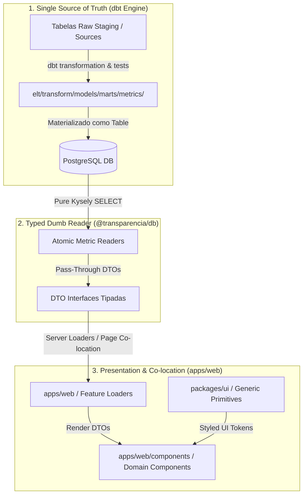

# Architecture Spine: Re-arquitetura de Integridade Contábil e UI

## 1. Visão Geral e Objetivo
Este documento define as **invariantes arquiteturais** do Portal de Transparência para erradicação total de discrepâncias contábeis, eliminando a fragmentação da inteligência fiscal atualmente espalhada entre queries runtime TypeScript, a camada `@transparencia/db` e a camada de apresentação.

---

## 2. Invariantes Arquiteturais e Decisões de Arquitetura (ADs)

### System Architecture Diagram


---

### Decisões Registradas (Architecture Decisions)

#### AD-1: dbt Marts de Métricas como Única Fonte da Verdade Contábil (SSOT)
* **Binds**: Toda e qualquer regra contábil, cálculo de saldo, consolidação de restos a pagar, agregações de empenho/liquidação/pagamento e cruzamentos fiscais.
* **Prevents**: Duplicação de regras de negócio em TypeScript, discrepâncias entre telas e falhas de auditoria contábil.
* **Rule**: Nenhuma query runtime em TypeScript pode realizar `SUM()`, `GROUP BY` ou cálculos contábeis brutos sobre dados transacionais brutos. Toda métrica apresentada na UI deve ser proveniente de modelos dedicados em `elt/transform/models/marts/metrics/`.

#### AD-2: Materialização de Marts de Métricas como Tabelas Físicas
* **Binds**: Estratégia de execução e persistência no banco PostgreSQL.
* **Prevents**: Latência de resposta na UI e concorrência excessiva de computação em tempo de leitura.
* **Rule**: Todos os modelos em `elt/transform/models/marts/metrics/` devem ser configurados com `materialized='table'` no dbt, garantindo que o banco de dados sirva leituras instantâneas à aplicação web.

#### AD-3: `@transparencia/db` como Leitor Burro Pass-Through Tipado
* **Binds**: A responsabilidade do pacote `@transparencia/db`.
* **Prevents**: Acúmulo de scripts monolíticos de montagem de telas e funções com agregações customizadas em runtime.
* **Rule**: O pacote `@transparencia/db` conterá apenas funções leitoras atômicas e genéricas ("pass-through") que espelham diretamente as tabelas/marts do dbt. Cada query Kysely fará estritamente um `selectFrom('fct_..._metricas').where('portal_slug', '=', portalSlug)`.

* **Typing Pattern (estabelecido em Story 2.1)**: Distinguir pelo escopo de uso:
  - **API pública de pacote** (`@transparencia/db`): declarar retorno explícito **e** usar `satisfies` no objeto de retorno — o tipo explícito documenta o contrato para o consumidor externo, o `satisfies` valida a estrutura no ponto de construção:
    ```typescript
    // ✅ padrão mandatório para funções exportadas de @transparencia/db
    export async function getXxxMetrics(
      portalSlug: string,
      ano: number,
      empresaIds: string[],
    ): Promise<XxxMetricsDTO | null> {
      // ...
      return { ...campos } satisfies XxxMetricsDTO;
    }
    ```
  - **Helper interno / co-localizado** (`apps/web` loaders, view models): retorno implícito é aceito — o compilador infere corretamente e a proximidade ao consumidor elimina a necessidade do contrato explícito.

* **DTO Shape Rules (estabelecido em Story 2.1)**: DTOs de métricas de mart NÃO devem expor:
  - **PKs internas do mart** (ex: `posicao_fiscal_id`, `analise_despesas_id`) — são detalhes de infraestrutura sem valor para o consumidor.
  - **Campos de FK de entidade** que se tornam ambíguos em visões consolidadas (ex: `empresa_id` quando múltiplas empresas são agregadas) — o chamador já conhece as entidades selecionadas via parâmetro.
  - DTOs devem conter apenas campos semânticos de negócio: identificadores de contexto (`portalSlug`, `ano`) e métricas numéricas.

* **empresaIds — Padrão de Consolidação Multi-Empresa (estabelecido em Story 2.1)**:
  - `empresaIds: string[]` é **obrigatório** (não opcional) em todas as funções leitoras de métricas.
  - Retorna `null` imediatamente se `empresaIds.length === 0`.
  - Quando múltiplas empresas são passadas, os campos numéricos são consolidados via `eb.fn.sum()` + `.groupBy(['portal_slug', 'ano'])` — consolidação sobre dados já pré-agregados no mart (permitida pelo AD-1, que proíbe SUM sobre dados transacionais brutos, não sobre métricas pré-computadas).
  - Este padrão é o **diferencial da plataforma** vs. portais oficiais que exibem apenas uma empresa por vez.
  ```typescript
  // ✅ padrão mandatório para funções de métricas com seleção de empresas
  export async function getXxxMetrics(
    portalSlug: string,
    ano: number,
    empresaIds: string[], // obrigatório, mínimo 1
  ): Promise<XxxMetricsDTO | null> {
    if (empresaIds.length === 0) return null;

    const result = await db
      .selectFrom("fct_xxx_metricas")
      .select((eb) => [
        "portal_slug",
        "ano",
        eb.fn.sum<string>("campo_numerico").as("campo_numerico"),
        // ...
      ])
      .where("portal_slug", "=", portalSlug)
      .where("ano", "=", ano)
      .where("empresa_id", "in", empresaIds)
      .groupBy(["portal_slug", "ano"])
      .executeTakeFirst();

    if (!result) return null;
    return { ...mapeamento } satisfies XxxMetricsDTO;
  }
  ```

#### AD-4: Reorganização da UI e Co-localização de Queries
* **Binds**: Organização de componentes entre `packages/ui` e `apps/web`.
* **Prevents**: Acoplamento de componentes de domínio no design system e dados buscados longe do ponto de consumo UI.
* **Rule**:
  1. `packages/ui` é restrito estritamente a primitivas genéricas e agnósticas de design system (ex: `Button`, `Card`, `Badge`, `DenseTable`, `KPIPrimitive`, `Sidebar`).
  2. Todos os componentes específicos de domínio/regra de negócio (ex: `PosicaoFiscalHero`, `CapremActuarialSection`, `SaudeEmendasCard`) pertencem a `apps/web/components/`.
  3. A composição do View Model e os data loaders devem ficar co-localizados no `apps/web` (próximo às páginas/componentes que consomem os dados), utilizando os leitores atômicos do `@transparencia/db`.

#### AD-5: Isolamento Multi-tenant Obrigatório via `portal_slug`
* **Binds**: Todas as queries SQL, modelos dbt e funções Kysely.
* **Prevents**: Leitura inadvertida de dados de múltiplos municípios ou vazamento de dados entre portais.
* **Rule**: Todos os modelos dbt em `marts/metrics/` devem obrigatoriamente incluir `portal_slug` em seu agrupamento (`GROUP BY`). Todas as funções leitoras em `@transparencia/db` devem exigir e aplicar obrigatoriamente o parâmetro `portalSlug`.

#### AD-6: Protocolo de Validação Fiscais em dbt e Paridade em CI/CD
* **Binds**: Fluxo de testes e integração contínua.
* **Prevents**: Regressão de dados contábeis, quebra de contratos de schema e falha nos testes efêmeros de integração.
* **Rule**:
  1. Testes de balanço e consistência contábil (ex: `empenhado >= liquidado >= pago`) pertencem à camada dbt (`dbt test`).
  2. Alterações de schema nas tabelas raw exigem atualização sincronizada em `elt/transform/models/staging/.../_sources.yml`.
  3. Nenhuma alteração é promovida sem a aprovação estrita dos comandos `make test` (Python/dbt) e `make test/ts` (TypeScript/Kysely).

---

## 3. Especificação dos Novos Marts de Métricas no dbt

Os modelos de métricas serão centralizados na pasta `elt/transform/models/marts/metrics/`:

### 3.1. `fct_posicao_fiscal_metricas.sql`
* **Propósito**: Consolidar a posição financeira diária/anual do município.
* **Granularidade**: `portal_slug` + `ano`
* **Campos Obrigatórios**:
  - `portal_slug` (VARCHAR) - Chave do tenant
  - `ano` (INTEGER) - Ano de exercício
  - `total_arrecadado` (NUMERIC(15,2)) - Soma de receitas efetivamente arrecadadas
  - `despesas_pagas` (NUMERIC(15,2)) - Soma de despesas pagas no exercício
  - `restos_pagos_no_ano` (NUMERIC(15,2)) - Restos a pagar quitados no ano
  - `restos_pendentes_adm_anterior` (NUMERIC(15,2)) - Restos pendentes de gestões passadas (definir uma forma de saber o que significa "anterior" vs. "atual" – talvez adicionar um campo um record em `dim_metadata` que indique o ano de referência da gestão anterior)
  - `restos_pendentes_adm_atual` (NUMERIC(15,2)) - Restos pendentes da gestão atual
  - `saldo_estimado` (NUMERIC(15,2)) - Total Arrecadado - Despesas Pagas - Restos Pagos
* **Invariante dbt**: `test: dbt_expectations / expression_is_true: "total_arrecadado >= 0"`

### 3.2. `fct_analise_despesas_metricas.sql`
* **Propósito**: Agregação de valores empenhados, liquidados e pagos por categorias contábeis.
* **Granularidade**: `portal_slug` + `ano` + `orgao_codigo` + `unidade_codigo` + `funcao_codigo`
* **Campos Obrigatórios**:
  - `portal_slug`, `ano`, `orgao_codigo`, `unidade_codigo`, `funcao_codigo`
  - `total_empenhado` (NUMERIC(15,2))
  - `total_liquidado` (NUMERIC(15,2))
  - `total_pago` (NUMERIC(15,2))
* **Invariante dbt**: `test: expression_is_true: "total_empenhado >= total_liquidado AND total_liquidado >= total_pago"`

### 3.3. `fct_execucao_orcamentaria_metricas.sql`
* **Propósito**: Comparativo de orçamento fixado vs. executado por função/subfunção.
* **Granularidade**: `portal_slug` + `ano` + `funcao_codigo` + `subfuncao_codigo`

### 3.4. `fct_fontes_receita_metricas.sql`
* **Propósito**: Acompanhamento da previsão vs. arrecadação por código de receita.
* **Granularidade**: `portal_slug` + `ano` + `codigo_receita`

---

## 4. Contrato de Leitura `@transparencia/db`

A camada `@transparencia/db` abandona a execução de sql customizado com agregações e passa a exportar leitores atômicos simples:

```typescript
// Exemplo do novo padrão de leitor burro em packages/db/src/queries/posicao-fiscal.ts
import { db } from "../client";

export interface PosicaoFiscalMetricsDTO {
  portalSlug: string;
  ano: number;
  totalArrecadado: number;
  despesasPagas: number;
  restosPagosNoAno: number;
  restosPendentesAdmAnterior: number;
  restosPendentesAdmAtual: number;
  saldoEstimado: number;
}

export async function getPosicaoFiscalMetrics(
  portalSlug: string,
  ano: number
): Promise<PosicaoFiscalMetricsDTO | null> {
  const result = await db
    .selectFrom("fct_posicao_fiscal_metricas")
    .selectAll()
    .where("portal_slug", "=", portalSlug)
    .where("ano", "=", ano)
    .executeTakeFirst();

  if (!result) return null;
  return result as unknown as PosicaoFiscalMetricsDTO;
}
```

---

## 5. Reorganização dos Componentes UI e Co-localização

```
transparencia/
├── apps/web/
│   ├── app/                    # Next.js App Router (Page Loaders & Routes)
│   │   ├── posicao-fiscal/     # Co-located Page Data Loader & View Model Assembly
│   │   └── despesas/
│   └── components/             # Componentes de DOMÍNIO (Específicos da Aplicação)
│       ├── posicao-fiscal-hero.tsx
│       ├── restos-pagar-card.tsx
│       ├── caprem-actuarial-section.tsx
│       ├── caprem-hero-section.tsx
│       ├── saude-hero-section.tsx
│       └── saude-emendas-section.tsx
└── packages/ui/
    └── src/
        └── components/         # Primitivas GENÉRICAS de UI (Design System Puro)
            ├── button.tsx
            ├── card.tsx
            ├── badge.tsx
            ├── dense-table.tsx
            ├── kpi-card.tsx
            ├── alert-box.tsx
            └── sidebar.tsx
```

---

## 6. Plano de Transição Seguro (Phased Rollout)

### **Fase 1: Marts de Métricas no dbt & Sincronização de Fontes**
1. Criar o diretório `elt/transform/models/marts/metrics/`.
2. Implementar `fct_posicao_fiscal_metricas.sql` e adicionar testes em `schema.yml`.
3. Sincronizar qualquer novo campo/tabela raw em `_sources.yml`.
4. Validar executando `make test`.

### **Fase 2: Refatoração dos Leitores `@transparencia/db`**
1. Atualizar Kysely schemas/leitores para consultar os novos Marts de Métricas.
2. Substituir queries com `sql` concatenado por leitores burros `.where('portal_slug', '=', portalSlug)`.
3. Validar tipagem e paridade executando `make test/ts`.

### **Fase 3: Reorganização da UI & Co-localização**
1. Mover componentes de domínio de `packages/ui/src/components/` para `apps/web/components/`.
2. Manter apenas componentes genéricos e primitivas de layout em `packages/ui`.
3. Co-localizar a montagem dos View Models nos data loaders do `apps/web`.

### **Fase 4: Migração dos Demais Domínios & Limpeza Geral**
1. Repetir o processo para `analise_despesas`, `fontes_receita`, `execucao_orcamentaria`, `historia_saude` e `historia_caprem`.
2. Remover código legado de agregação e garantir aprovação de 100% no pipeline de testes (`make test` e `make test/ts`).

---

## 7. Questões em Aberto

### QA-1: Carga nacional (todas as cidades, ~4 anos) e a materialização dos marts (AD-2)
* **Origem:** Story 25.6c (fonte em massa do DATASUS para a rede e a produção de saúde) e issue #55 (marts leves como views, dimensões extraídas das fatos). Registrada em 2026-11-07. **Nenhum AD existente foi alterado**; o AD-2 continua valendo até a #55 decidir.
* **Custo de carga não é custo de modelo.** A extração nacional cresce com UFs e meses (27 UFs × 4 anos; medido no GitHub Actions, RJ 2025-12: ~15 min por UF por mês fechado, dominado pelo SIA, independente do número de cidades). Isso é tratado pela cadência da Story 23.8 (um job por UF, incremental), não pelos modelos dbt.
* **O raw de saúde é pequeno.** `raw_saude_rede` guarda linhas já agregadas por município e competência (chave primária começa por `portal_slug`), na ordem de centenas de milhares de linhas para o Brasil. Os marts de saúde (`fct_saude_rede_por_mil_moradores_metricas`, `fct_saude_producao_sus_metricas`) agregam por `(portal_slug, ano)` e a leitura sempre filtra por `portal_slug`, então são candidatos naturais a view com filter pushdown se a #55 revisar o AD-2.
* **Chave nacional (decisão pendente, afeta o AD-5):** hoje o tenant é o portal (`portal_slug`, uma prefeitura cadastrada). Cobrir cidades que não são portais exige decidir se a chave vira `cod_ibge` ou se a carga segue só os portais cadastrados. Decidir na #55 ou na Story 23.8, antes de qualquer carga nacional.
* **Regra enquanto isso:** não transformar marts em view dentro de stories de funcionalidade; a mudança é da #55.
