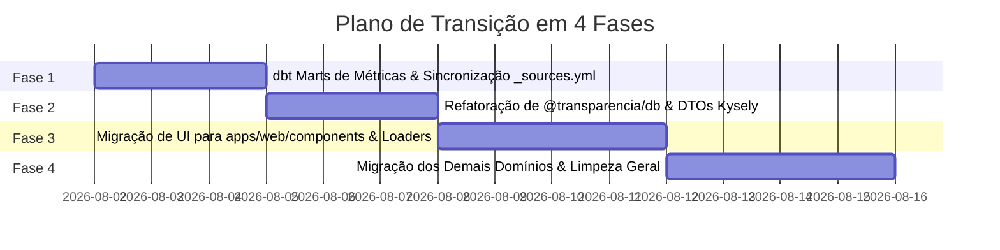

# Documento de Requisitos de Produto (PRD)
## Re-arquitetura de Integridade Contábil e UI

---

## 1. Visão Geral e Problema Atual

### 1.1. Contexto do Produto
O Portal de Transparência Pública é uma plataforma crítica responsável por apresentar demonstrativos contábeis, execução orçamentária, gastos com pessoal, despesas com saúde, previdência (CAPREM) e licitações de municípios. Devido à natureza jurídica do portal, existe **TOLERÂNCIA ZERO** a discrepâncias de cálculo ou agregações incorretas (risco legal e reputacional).

### 1.2. Problema Atual
Atualmente, o sistema sofre de fragmentação da inteligência contábil:
1. **Queries Kysely Complexas**: Funções em `@transparencia/db/src/queries/` realizam agregações complexas em tempo de execução TypeScript (`SUM()`, `GROUP BY`, joins transacionais dinâmicos e parsing de dados).
2. **Componentes Acoplados**: Componentes específicos de negócio (como seções de saúde e previdência) estão localizados incorretamente no pacote de design system `packages/ui`.
3. **Fragilidade de Manutenção**: Mudar uma regra fiscal exige alterar código TypeScript na camada de dados e ajustar contratos na UI.

---

## 2. Invariantes de Arquitetura (Herança do ARCHITECTURE-SPINE.md)

Este PRD herda estritamente as 6 Decisões de Arquitetura (ADs) ratificadas no [ARCHITECTURE-SPINE.md](file:///Volumes/Projects/transparencia/_bmad-output/planning-artifacts/architecture/architecture-transparencia-2026-08-01/ARCHITECTURE-SPINE.md):
- **AD-1**: dbt como Única Fonte da Verdade (SSOT) para métricas fiscais.
- **AD-2**: Materialização de Marts de Métricas como Tabelas Físicas (`materialized='table'`).
- **AD-3**: `@transparencia/db` como leitor burro tipado ("pass-through" via Kysely).
- **AD-4**: UI pura — `packages/ui` para primitivas genéricas e `apps/web/components` para componentes de domínio.
- **AD-5**: Isolamento Multi-tenant obrigatório por `portal_slug`.
- **AD-6**: Garantia de qualidade fiscal via `dbt test`, `make test` e `make test/ts`.

---

## 3. Requisitos Funcionais (FRs)

### FR-1: Consolidação de Métricas no dbt (`elt/transform/models/marts/metrics/`)
- **FR-1.1**: O dbt deve fornecer o modelo `fct_posicao_fiscal_metricas.sql` pré-calculando total arrecadado, despesas pagas, restos pagos e pendentes (separados por gestão anterior vs. atual com auxílio do ano de referência em `dim_metadata`).
- **FR-1.2**: O dbt deve fornecer o modelo `fct_analise_despesas_metricas.sql` pré-agregando totais empenhados, liquidados e pagos por órgãos, unidades e funções contábeis.
- **FR-1.3**: O dbt deve fornecer os modelos `fct_execucao_orcamentaria_metricas.sql` e `fct_fontes_receita_metricas.sql` para suporte a gráficos orçamentários.
- **FR-1.4**: Todos os modelos de métricas devem incluir a dimensão `portal_slug` em seu agrupamento obrigatório.
- `[ASSUMPTION]`: Assumimos que os modelos em `marts/metrics/` manterão projeções cirúrgicas de colunas (sem incluir texto bruto de empenho/historicos longos) para prevenir inflação de memória no banco.

### FR-2: Leitores Atômicos no `@transparencia/db`
- **FR-2.1**: A camada `@transparencia/db` deve substituir scripts monolíticos de montagem de telas por leitores burros atômicos (ex: `getPosicaoFiscalMetrics(portalSlug, ano)`).
- **FR-2.2**: Nenhuma função em `@transparencia/db` pode conter chamadas a `sql` com agregações `SUM()`, `AVG()` ou `GROUP BY` sobre dados transacionais brutos.
- **FR-2.3**: Todas as funções leitoras devem exigir obrigatoriamente o parâmetro `portalSlug`.

### FR-3: Reorganização da Camada de Apresentação (UI)
- **FR-3.1**: Mover componentes de domínio de `packages/ui/src/components/` para `apps/web/components/` (ex: `caprem-hero-section.tsx`, `saude-emendas-section.tsx`, `posicao-fiscal-hero.tsx`).
- **FR-3.2**: Manter em `packages/ui` apenas primitivas agnósticas de design system (ex: `button.tsx`, `card.tsx`, `dense-table.tsx`, `kpi-card.tsx`).
- `[ASSUMPTION]`: Assumimos uma estrutura plana dentro de `apps/web/components/` conforme ajustado no documento de arquitetura.

### FR-4: Co-localização de Data Loaders e View Models
- **FR-4.1**: Os data loaders e a composição de View Models devem residir em `apps/web/app/` (próximo às rotas que renderizam as telas).
- **FR-4.2**: Os componentes UI devem receber apenas DTOs prontos passados via props.

---

## 4. Requisitos Não-Funcionais (NFRs)

### NFR-1: Desempenho e Latência
- **NFR-1.1**: Leituras das páginas principais (ex: Posição Fiscal) na web devem responder em menos de 100ms no banco de dados PostgreSQL devido à pré-materialização física (`materialized='table'`).

### NFR-2: Integridade e Tolerância Zero a Erros
- **NFR-2.1**: Testes fiscais e balanços contábeis (ex: `empenhado >= liquidado >= pago`) devem falhar a compilação do dbt caso haja discrepância nos dados.

### NFR-3: Manutencibilidade e Testabilidade
- **NFR-3.1**: Mudanças em schemas de staging exigem atualização em `_sources.yml` para garantir que os testes de integração (`make test`) passem sem erro.
- **NFR-3.2**: Testes TypeScript (`make test/ts`) devem validar que todas as queries Kysely mantêm tipagem forte e passam o filtro `portal_slug`.

---

## 5. Plano de Fases (Rollout)

---

## 6. Lista de Tags de Suposições (`[ASSUMPTION]`) para Validação

1. **`[ASSUMPTION]` Projeções Enxutas de Métricas**: Assumimos que as tabelas em `marts/metrics/` conterão apenas os campos estritamente necessários para os KPIs e gráficos da UI, omitindo campos de texto longo como histórico de empenhos ou descrições detalhadas de credores.
2. **`[ASSUMPTION]` Referência de Gestão em `dim_metadata`**: Assumimos que `dim_metadata` conterá um campo `ano_inicio_gestao_atual` para permitir o cálculo exato de restos a pagar da administração anterior vs. atual.
3. **`[ASSUMPTION]` Estrutura Plana de Componentes**: Assumimos que os componentes em `apps/web/components/` usarão nomes descritivos com hífens em um diretório plano (ex: `apps/web/components/posicao-fiscal-hero.tsx`).

---

## 7. Critérios de Aceite Globais

- [ ] Todos os testes em `make test` (Python/dbt) passam sem erros.
- [ ] Todos os testes em `make test/ts` (Kysely/TypeScript) passam sem erros.
- [ ] Nenhuma query em `@transparencia/db/src/queries/` realiza `SUM()` ou `GROUP BY` em runtime.
- [ ] Nenhum componente de domínio específico permanece dentro de `packages/ui`.
